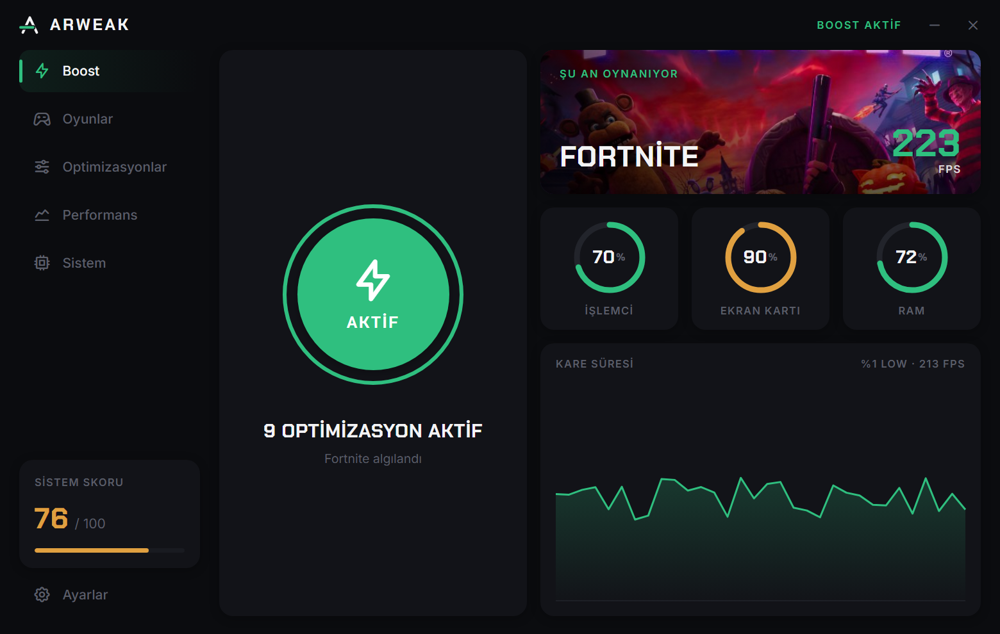

# Arweak

Windows'ta oyunları daha akıcı çalıştırmak için bir araç. Boost'a basınca seçtiğiniz optimizasyonları uygular, kapatınca hepsini eski haline getirir.



- Boost seçili optimizasyonları uygular. İsterseniz oyun açılınca kendisi devreye girer.
- Fortnite, Valorant, CS2, Apex Legends, League of Legends, Minecraft, GTA V ve Rocket League için profil var. Yüklü oyunları kendisi bulur.
- Oyun sırasında ortalama FPS, %1 low, kare süresi ve takılma sayısını ölçer. Boost açıkken ve kapalıyken alınan FPS'i yan yana gösterir. Ölçüm için [PresentMon](https://github.com/GameTechDev/PresentMon) kullanılır.
- RAM'in tek kanalda çalışıp çalışmadığını, EXPO/XMP'yi, monitörün yenileme hızını, Oyun Modu, HAGS ve güç planını kontrol eder.
- RAM önbelleğini elle ya da oyun sırasında bellek azalınca otomatik temizler.
- Arka planda çalışır, Windows ile açılabilir, kapatınca tepsiye iner.

## İndirme

[Releases](../../releases) sayfasında iki dosya var:

| Dosya | |
|---|---|
| `Arweak_1.0.0_Setup.exe` | Kurulum sihirbazı |
| `Arweak.exe` | Kurulum gerektirmez, tek dosya |

Windows 10 veya 11 (64 bit) gerekir. Uygulama yönetici izniyle açılır.

## Optimizasyonlar

| Optimizasyon | Ne yapar | Yeniden başlatma |
|---|---|---|
| Ultimate güç planı | Windows'un gizli "Ultimate Performance" planını açar | Gerekmez |
| Game Bar kaydını kapat | Arka planda sürekli yapılan oyun kaydını kapatır | Gerekmez |
| Oyuna yüksek öncelik | Oyun açılınca işlemine yüksek öncelik verir | Gerekmez |
| Oyunda arka planı kıs | Oyun sırasında tarayıcı, OneDrive gibi uygulamaların önceliğini düşürür | Gerekmez |
| GPU maksimum performans | PCIe güç tasarrufunu kapatır, oyunlarda yüksek performanslı GPU'yu seçer | Gerekmez |
| Windows Oyun Modu | Oyun Modunu açar | Gerekmez |
| Donanım hızlandırmalı zamanlama | HAGS'ı açar | Gerekir |
| Çoklu düzlem kaplamasını kapat | MPO'yu kapatır, bazı sistemlerde ekran titremesini giderir | Gerekir |
| Akıllı RAM temizleme | Oyun sırasında boş bellek azalınca Windows önbelleğini boşaltır | Gerekmez |
| Ağ güç tasarrufunu kapat | Ağ kartının güç tasarrufunu kapatır | Gerekmez |
| Nagle algoritmasını kapat | TCP paketlerinin bekletilmesini kapatır | Gerekmez |
| Yüksek çözünürlüklü zamanlayıcı | Zamanlayıcı çözünürlüğünü sistem geneline yayar (Windows 11) | Gerekir |

RAM temizleme sadece Windows'un bekleme önbelleğini (standby) boşaltır. Programların belleğine dokunmaz, bu yüzden oyunda takılma yapmaz.

## Geri alma

Arweak bir ayarı değiştirmeden önce eski değerini `C:\ProgramData\Arweak\backup.json` dosyasına yazar. Boost kapanınca ya da Ayarlar'daki **Tüm değişiklikleri geri al** ile her şey eski haline döner. İsterseniz önce **Yedek noktası oluştur** ile bir Windows geri yükleme noktası alabilirsiniz.

## Hile korumalı oyunlar

Arweak oyun dosyalarına ya da oyunun belleğine dokunmaz. Sadece Windows ve sürücü ayarlarını değiştirir, oyun işlemine öncelik verir. Valorant gibi çekirdek seviyesinde koruması olan oyunlarda öncelik ayarı engellenebilir. Bu durumda o ayar atlanır, diğerleri çalışmaya devam eder.

## Derleme

Node.js 18+, Rust (stable, MSVC) ve Visual Studio Build Tools ("C++ ile masaüstü geliştirme") gerekir.

```bash
npm install
npm run build
```

Çıkan dosyalar `release/` klasörüne kopyalanır. `npm run assets` fontları, `npm run icons` ikonları yeniden üretir.

## Klasörler

| Yol | İçerik |
|---|---|
| `ui/` | Arayüz (HTML, CSS, JS). Tarayıcıda açılırsa örnek verilerle çalışır. |
| `src-tauri/src/main.rs` | Uygulama durumu, arayüz komutları, tepsi |
| `src-tauri/src/tweaks.rs` | Optimizasyonlar ve geri alma kayıtları |
| `src-tauri/src/monitor.rs` | İşlemci, GPU ve RAM ölçümü, oyun algılama, PresentMon |
| `src-tauri/src/games.rs` | Oyun listesi, Steam, Epic ve Riot kurulumlarını bulma |
| `src-tauri/src/sysinfo.rs` | Sistem kontrolü ve skor |
| `src-tauri/src/memory.rs` | Bellek durumu ve önbellek temizleme |
| `src-tauri/tools/PresentMon.exe` | FPS ölçümü için exe'nin içine gömülen araç |

## Lisans

[GPL-3.0-or-later](LICENSE). Kullanılan diğer bileşenler [THIRD_PARTY.md](THIRD_PARTY.md) dosyasında.
